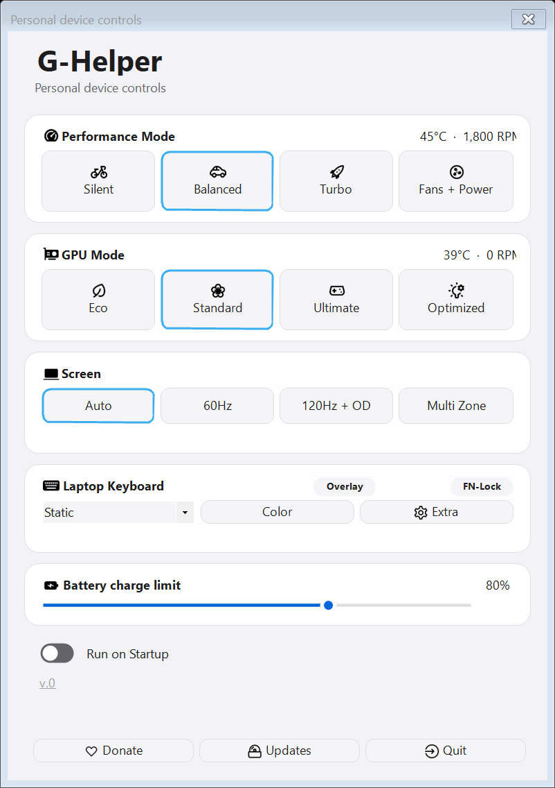
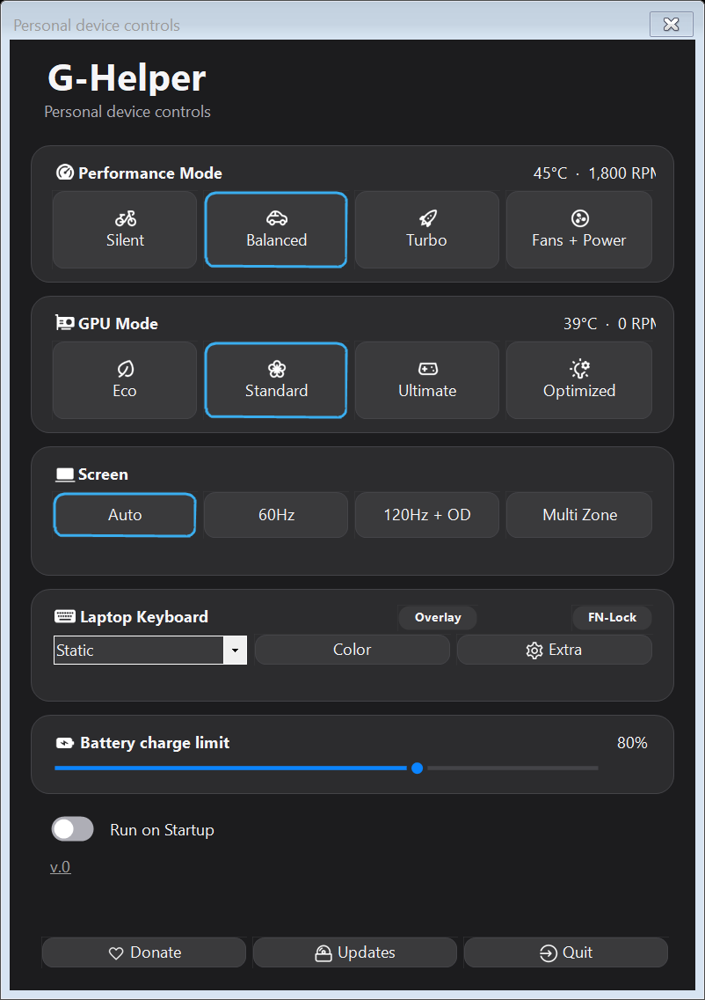
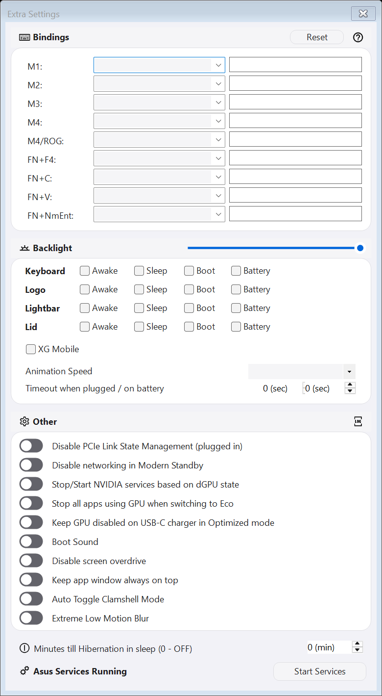
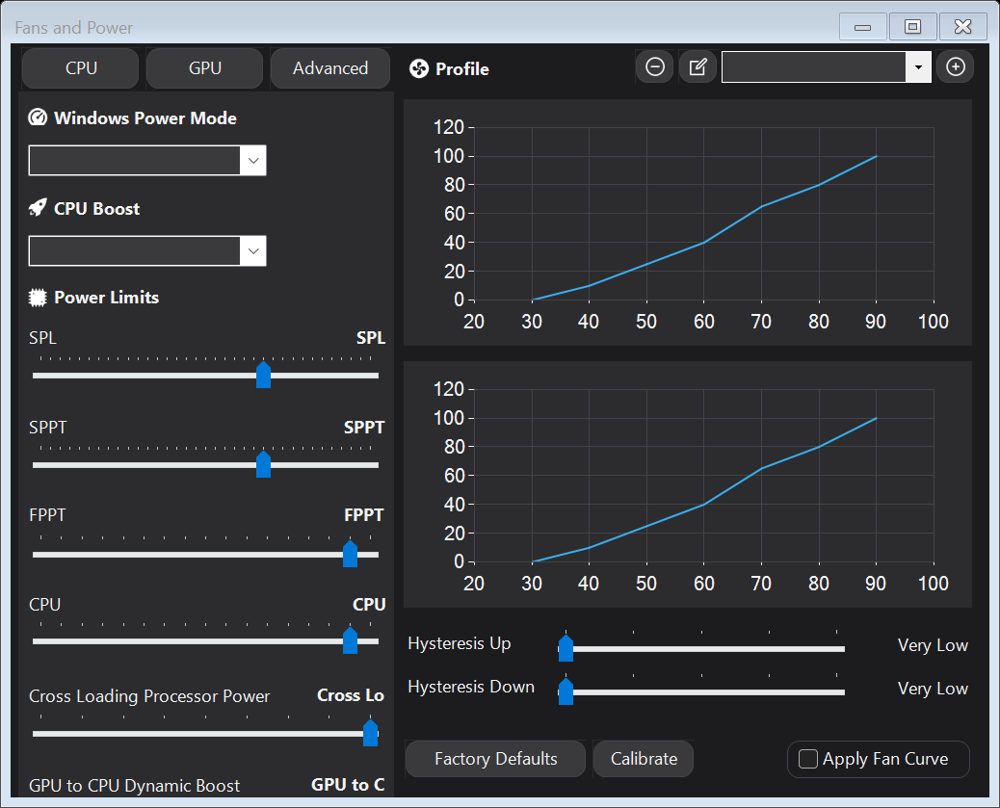

# G-Helper personal UI fork

This personal fork refreshes [G-Helper by seerge and contributors](https://github.com/seerge/g-helper). Original GPL-3.0 licensing, attribution, hardware control, profiles, configuration format, hotkeys and tray implementation remain in place. This is an independently built, unsigned personal variant, not an official upstream release.

## Build and run

Requires Windows x64 and the .NET 10 SDK to build; the .NET 10 Desktop Runtime to run. No additional application dependencies were added.

```powershell
dotnet build app/GHelper.csproj -c Release -p:GITHUB_ACTIONS=true
dotnet publish app/GHelper.csproj -c Release -r win-x64 --self-contained false -p:PublishSingleFile=true -p:GITHUB_ACTIONS=true -o artifacts/GHelper-Apple
```

Run `artifacts/GHelper-Apple/GHelper.exe`. `GITHUB_ACTIONS=true` suppresses upstream's build-time stop-running-app and ZIP targets; it does not change application behavior. The project-local SDK used during development is under ignored `tools/dotnet/`; substitute that executable for `dotnet` if needed.

The normal application uses the existing G-Helper configuration and hardware behavior. Close your existing G-Helper before trying this build. The built-in updater still checks upstream releases; applying an upstream update can replace this personal UI. No update, hardware, startup-task or persistence logic was redirected.

## What changed

- A compact, resizable Control Center with a clear title, grouped surfaces, persistent footer and keyboard-accessible scrolling when content exceeds the window.
- Shared opaque light/dark colors, typography and spacing/corner tokens in `app/UI/DesignSystem.cs`. Existing system theme selection and optional flat appearance remain available; high-contrast colors use Windows system colors.
- Reusable card panels and native CheckBox-based toggles for startup and general settings. Fan/GPU/advanced groups share the same surfaces; other windows inherit the common controls and palette.
- Flat rounded buttons and dropdown outlines, with existing native text/image layout, mnemonics, focus, disabled state and accessibility. Existing native TrackBars keep their input/range behavior and receive a simpler track/thumb paint treatment.
- Cached button geometry replaces per-paint window Region assignment and gradient drawing. Slider/badge decoration timers were removed. Slider paint brushes are disposed deterministically.

Only one presentation setup call was added to the main constructor. Hardware event subscriptions and all hardware/configuration source files are unchanged. Original control names and hardware-specific visibility decisions remain in use. No web renderer, new package, font download, polling task or continuous animation was added.

## Screenshots

These are actual WinForms `DrawToBitmap` renders at the host's 144 DPI (150%), with explicitly synthetic sensor readings, fan curves and selection state. The verification copy does not run hardware initialization. `DrawToBitmap` does not capture DWM framing and can show the native print appearance of dropdowns/TrackBars rather than their on-screen paint treatment.






## Verification and performance

Upstream baseline: `03c6b8a36a350b142e8c6dc278a79ea3e3f740d8`. Release build and framework-dependent single-file publish succeeded with zero warnings/errors using SDK 10.0.403. The application project and package references are unchanged.

The UI verifier builds a disposable copy of the source and replaces eight form constructors **only in that copy** with designer/theme initialization, bypassing hardware event wiring and two hardware-reading field initializers. It also bypasses main-window system-power handling. The test entry point and startup-local configuration exist only in the disposable copy. The production executable has its original entry point and full normal initialization.

```powershell
./tests/UiVerification/Verify.ps1 -Output ./artifacts/ui-check -Dotnet dotnet
# Use an unmodified upstream checkout to compare:
./tests/UiVerification/Verify.ps1 -Source C:/path/to/upstream -Output ./artifacts/upstream-check -Dotnet dotnet
```

Choose fresh output folders. The verifier captures eight forms in both themes, checks button/disabled dispatch, slider keyboard steps/bounds/discrete values, toggle CheckedChanged/accessibility state, and compact-main scrolling/footer access. All 111 original main-window child control names were retained; the shell adds two controls. Screens rendered: main, fans, extra settings, updates, handheld, Matrix, Slash, overlay configuration.

The following are synthetic UI measurements from one machine, with five warm-up construction samples and five batches of 5,000 button paints per theme. Baseline and redesigned final runs were sequential. Raw results are in `docs/apple-ui/measurements/`.

| Measurement | Upstream light | Redesign light | Upstream dark | Redesign dark |
| --- | ---: | ---: | ---: | ---: |
| Median 5,000 button paints | 6,564.9 ms | 2,440.3 ms | 10,821.0 ms | 2,892.6 ms |
| Median allocated bytes / 5,000 paints | 8,354,144 | 4,480,320 | 8,280,320 | 4,480,320 |
| Median warm main-form construction | 51.55 ms | 52.50 ms | 59.88 ms | 64.10 ms |
| Private bytes after UI suite | 68,878,336 | 53,514,240 | 67,502,080 | 53,501,952 |
| CPU time over 2-second UI idle sample | 62.5 ms | 31.25 ms | 46.875 ms | 93.75 ms |

Button repaint medians improved by about 63% / 73%, with about 46% less managed allocation. Steady-state GDI deltas were zero in these final samples. Main-form construction was about 1 ms / 4 ms slower in these samples. Short idle samples and first construction times varied substantially and are not reliable full-application startup/idle benchmarks. Private bytes after the multi-window synthetic suite are not the application's normal RAM usage.

**No claim of complete no-regression or hardware acceptance is made.** Real-device startup, long idle CPU/RAM, sensor updates, tray reopen/hide behavior, hardware actions, hotkeys, profile persistence, live theme switching, screen-reader/keyboard interaction, all hardware-specific layouts, and physical 100%/200%/mixed-monitor DPI still need supported-device verification. Peripheral dialogs inherit shared styling but were not included in this UI capture suite. The testing host used 150% DPI; compact-window checks are size tests, not additional physical DPI tests.

## Maintenance

Keep hardware modules untouched when merging upstream. UI changes are concentrated in `app/UI/`, `Settings.Appearance.cs`, and small designer substitutions/padding changes in three forms. Tests and screenshots are separate from the production application. Existing icons and system typography are retained for localization/layout compatibility. GPL-3.0 and original upstream documentation remain intact.
